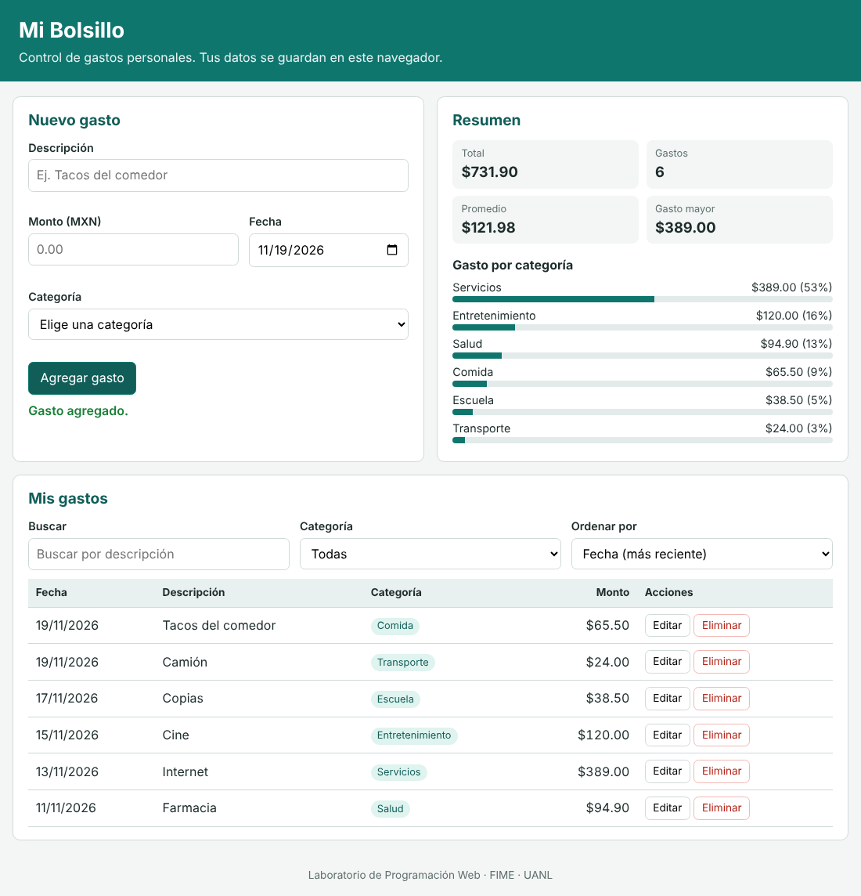
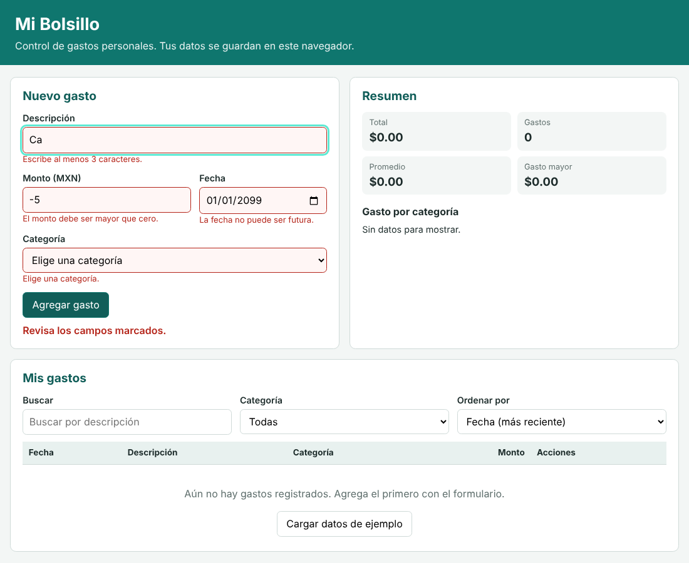
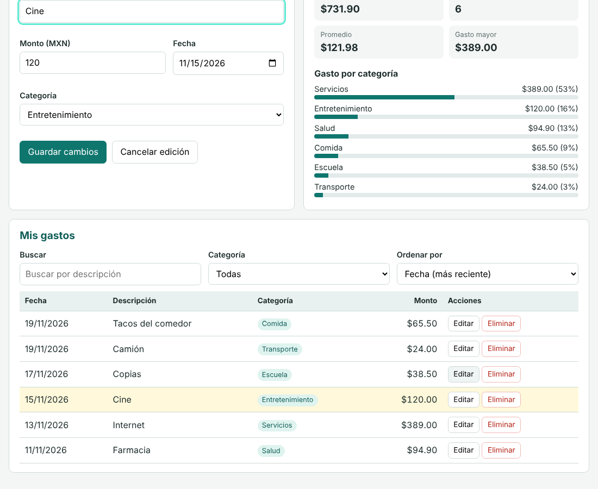
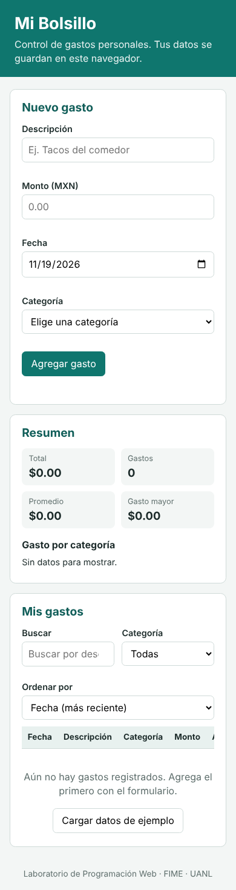

# Mi Bolsillo – Control de gastos personales

Aplicación web del lado del cliente para registrar, consultar, modificar y eliminar gastos, sin servidor ni base de datos. Los datos se conservan en el navegador con `localStorage`.

Proyecto de la **Actividad 3 – Aplicación interactiva con JavaScript moderno** del Laboratorio de Programación Web (FIME, UANL).

**Autora:** Patricia Lizeth Ramos Ortiz · ITS · Brigada 406 · Plan 440



## Qué hace

- **Agregar** gastos con descripción, monto, fecha y categoría.
- **Visualizar** los gastos en una tabla.
- **Editar** un gasto: el formulario se llena con sus datos y cambia a "Guardar cambios" (la fila se marca en amarillo).
- **Eliminar** un gasto, con confirmación.
- **Validar** los datos antes de guardar, con mensajes junto a cada campo.
- **Guardar y recuperar** todo con `localStorage`: al recargar la página o volver otro día, los gastos siguen ahí.
- **Funciones adicionales**: búsqueda por descripción, filtro por categoría, ordenamiento (fecha o monto) y resumen automático (total, cantidad, promedio, gasto mayor y gasto por categoría con porcentajes).

## Cómo usarla

No necesita instalación ni servidor.

1. Descarga o clona el repositorio.
2. Abre `index.html` en el navegador (probado en Google Chrome).
3. Si la lista está vacía, puedes pulsar **Cargar datos de ejemplo** para probarla rápido.

## Estructura del proyecto

```
mi-bolsillo/
├── index.html        # estructura semántica de la página
├── css/styles.css    # estilos y diseño adaptable (escritorio y móvil)
├── js/app.js         # toda la lógica, dividida en secciones comentadas
├── docs/             # capturas de pantalla para este README
├── DEMO.md           # guion de la demostración de 3 minutos
└── README.md
```

## Cómo cumple las instrucciones de la actividad

| # | Instrucción | Dónde está en el código |
|---|-------------|--------------------------|
| 1 | Aplicación tipo gestor (control de gastos) | Toda la aplicación |
| 2 | Modelar datos con objetos y arreglos | Arreglo `gastos` de objetos `{ id, descripcion, monto, categoria, fecha }` |
| 3 | Agregar, visualizar, editar y eliminar | `agregarGasto`, `renderizarTabla`, `editarGasto`, `eliminarGasto` (sección 6) |
| 4 | Manipular el DOM sin recargar | `renderizar()` reconstruye tabla y resumen con `createElement`, `append` y `replaceChildren` |
| 5 | Eventos, funciones y sintaxis moderna | `addEventListener` (submit, click, input, change); `let`/`const`, template literals, arrow functions, desestructuración, spread, `??`, `map`, `filter`, `reduce`, `sort`, `find` |
| 6 | Validar y mostrar mensajes claros | `validar()` y `mostrarErrores()` (sección 5); mensajes con `aria-live` |
| 7 | Guardar y recuperar con localStorage | `cargarGastos()` y `guardarGastos()` (sección 4) |
| 8 | Función adicional | Búsqueda, filtro por categoría, ordenamiento y resumen automático (sección 8 y `renderizarResumen`) |

## Decisiones de diseño

- **Sin `innerHTML` con datos del usuario.** Las filas se crean con `createElement` y `textContent`, así que lo que se escriba en la descripción nunca se interpreta como HTML.
- **Validación en tres niveles.** Se valida al enviar el formulario (descripción de 3 a 60 caracteres, monto mayor que 0 y hasta $1,000,000, fecha no futura, categoría obligatoria). Además, al cargar de `localStorage` se descartan los registros inválidos, y si el JSON guardado está dañado la aplicación arranca vacía en lugar de fallar.
- **Montos redondeados a dos decimales** para evitar errores de coma flotante en las sumas.
- **Un solo script sin módulos.** Así funciona abriendo `index.html` directamente (los módulos ES requieren servidor). Para mantener el orden, `app.js` está dividido en secciones numeradas.
- **Accesibilidad básica.** Etiquetas `label` en cada campo, `aria-invalid` y `aria-live` en los errores, foco visible y una tabla con encabezados `th scope="col"`.

## Pruebas realizadas

Las probé en Google Chrome, de forma automática y revisando capturas:

- Enviar el formulario vacío, con monto negativo y con fecha futura muestra los errores correspondientes.
- Agregar, editar y eliminar gastos actualiza la tabla y el resumen; cancelar la confirmación de eliminar no borra nada.
- Los datos sobreviven a recargar la página.
- Con 6 gastos de ejemplo el total automático coincide con la suma hecha a mano ($731.40).
- Con datos corruptos en `localStorage` la aplicación no se rompe.
- El diseño se adapta a pantalla de celular (390 px de ancho).

| Validación | Edición | Celular |
|---|---|---|
|  |  |  |

## Limitaciones

- Los datos viven solo en el navegador y equipo donde se capturaron; si se borra la información del sitio, se pierden.
- No hay exportación ni sincronización entre dispositivos.

## Publicación en GitHub Pages (opcional)

```bash
git init
git add .
git commit -m "Mi Bolsillo: gestor de gastos con JavaScript moderno"
git branch -M main
git remote add origin https://github.com/<tu-usuario>/mi-bolsillo.git
git push -u origin main
```

Después, en el repositorio: **Settings → Pages → Branch: `main` / carpeta `/ (root)`**. La página quedará en `https://<tu-usuario>.github.io/mi-bolsillo/`.
